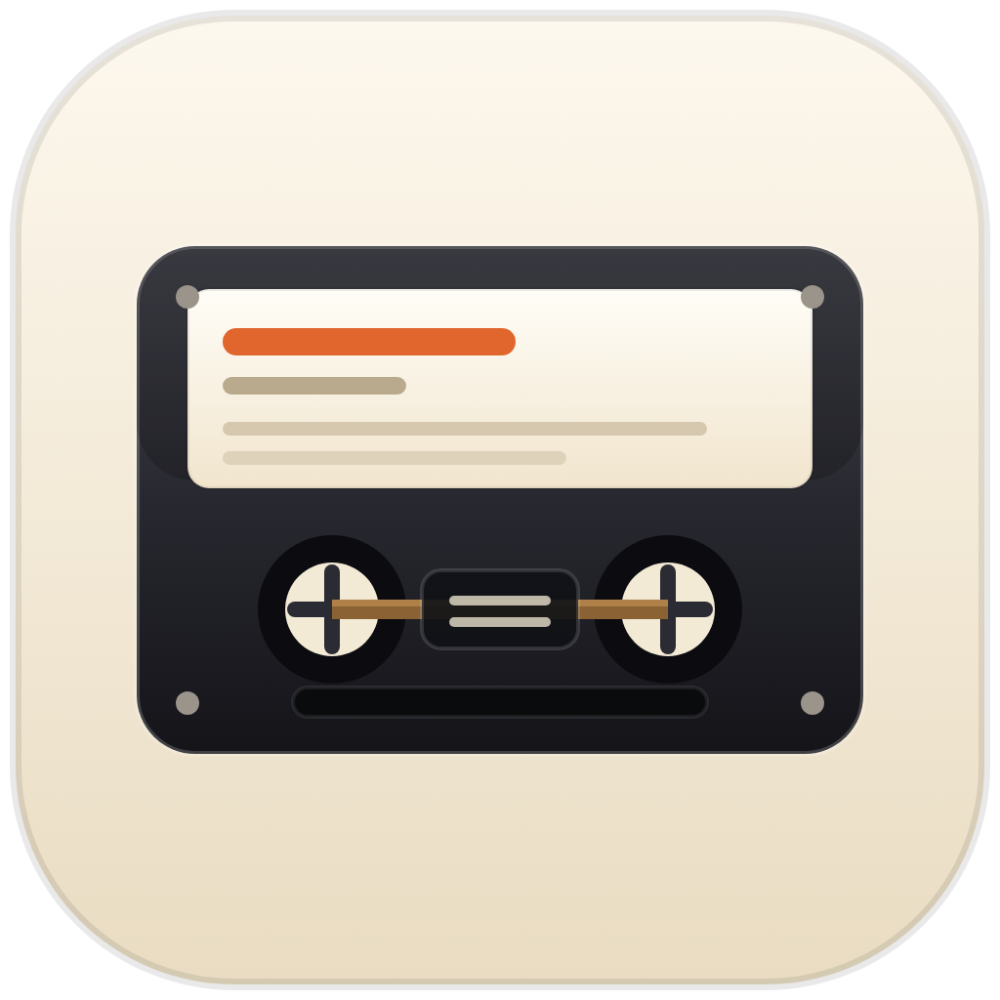
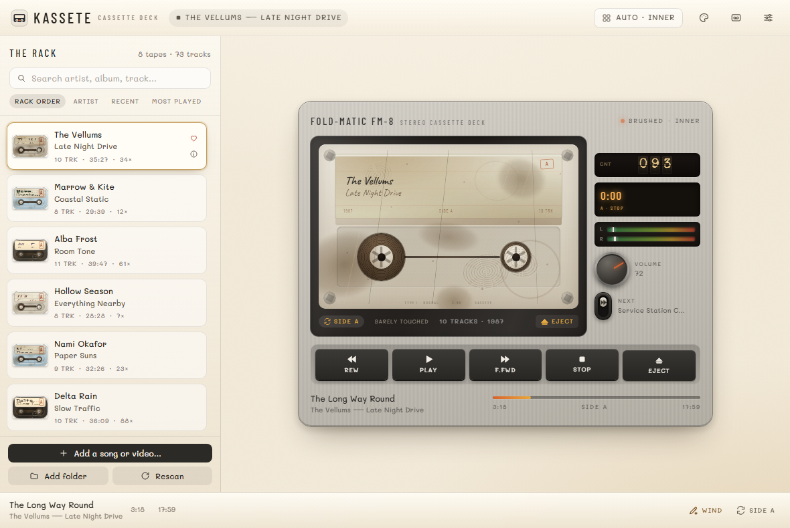

<p align="center">
  
</p>

<h1 align="center">KASSETE</h1>
<p align="center"><b>A cassette deck for your PC.</b><br/>
Real tapes, real reels, real hiss — built with Tauri, Svelte 5 and a lot of affection for 1987.</p>

<p align="center">
  <a href="https://github.com/NOOBHEKER/KASSETE/releases/latest"></a>
  
  
  <a href="https://noobheker.github.io/KASSETE/"></a>
</p>



KASSETE turns a folder of music into a shelf of cassettes. Every album becomes a tape
with a hand-written J-card, a shell you can see through, and reels that actually turn.
Click a tape, press play, and the deck behaves like the real thing — pause lifts the
tape, side B flips the reels, and fast-forward moves the head ten seconds at a time.

It is not a music player with a retro skin. It is a small, complete cassette world.

---

## Install

### Windows installer (recommended)

1. Grab **`KASSETE_1.0.0_x64-setup.exe`** from the [latest release](https://github.com/NOOBHEKER/KASSETE/releases/latest).
2. Run it. KASSETE installs into your user profile and adds a Desktop and Start Menu
   shortcut — click the cassette icon and it opens, exactly like any other app.

### One line in PowerShell

```powershell
irm https://raw.githubusercontent.com/NOOBHEKER/KASSETE/main/install.ps1 | iex
```

### Microsoft Store

The Store build (MSIX) is prepared in [`tools/make-msix.ps1`](tools/make-msix.ps1);
the listing is on its way. Until then the installer above is the same app.

### Portable

Download the `-portable.zip` from the release, unzip anywhere, run `KASSETE.exe`.
No installer, no registry, no leftovers.

### Try it without installing

The whole UI runs in a browser with a demo shelf:
**<https://noobheker.github.io/KASSETE/>** — nothing to install, nothing uploaded.
The [docs](docs/) folder is that build, so the demo ships in the repository itself.

---

## What's inside

**The deck**
- Two layouts that hinge open like a real player: **cover** and **inner**;
  *Auto* switches as the window narrows.
- Ten decks, from the silver FM-8 Classic to the neon FX-79 Original, each with
  brushed / matte / crystal finishes.
- Five cassette shells — Cream, Smoked, Frosted blue, Clear, Black — plus label
  styles (typewriter, handwriting, printed, marker) and ink colours.
- Physical controls: transport keys with real travel, a volume knob that follows
  your mouse around its arc, a spring-loaded **Next** lever under the knob, and an
  eject key that lifts the cassette out of the well.

**The tape**
- Every track is a real file; playback is plain audio with a tape-shaped soul.
- **Rew / F.Fwd move the head ±10 seconds.** Next/previous live on the lever,
  the queue, and Shift + arrows.
- Pause is also eject: the tape stops, lifts, and the drawer of tapes comes up.
- Auto-reverse at the end of a side, a tape counter, VU meters with needles, and
  reels whose speed eases with the music.
- Wear, dirt and stretch accumulate as you listen. The **Bench** lets you clean,
  rewind and restore a tired tape.

**Now playing & insight**
- A full Now Playing screen: big cassette, scrub bar, transport, side queue.
- Choose a **clear shell** and the deck turns see-through: metal shield, pressure
  pad, felt spring, pinch roller, capstan, guide posts, slip sheets and erase tab,
  all visible through the plastic. Press **I** (or the *inside* pill) for the
  annotated **Inside a cassette** sheet — what every part does, plus your tape's
  health.

**The shelf**
- Import a folder, a handful of files, or an Android Foldman/KASSETE export.
- Search, sort by artist / recent / most played, and favourite tapes.
- Recent-tape resume, a mini player, and a tray icon that keeps the deck alive
  when the window is closed.

**Privacy**
No accounts, no telemetry, no network calls. Your library is one JSON file:

```
%APPDATA%\app.kassete.deck\kassete-library.json
```

Music stays where it is; KASSETE only stores paths and the tape you built around them.

---

## Keyboard

| Key | Action |
| --- | --- |
| `Space` | Play / pause |
| `←` / `→` | Rewind / forward 10 seconds |
| `Shift` + `←` / `→` | Previous / next track |
| `N` | Next track |
| `F` | Flip the tape (side A ↔ B) |
| `E` | Eject |
| `I` | Inside a cassette |
| `S` | Settings |
| `Ctrl` + `O` | Add music |
| `Ctrl` + `B` | Cycle hinge mode |
| `Esc` | Close a sheet |

---

## Build it yourself

You need **Node 20+**, **Rust (stable)**, the **WebView2 runtime** (already on
Windows 11) and the MSVC build tools.

```powershell
npm install
npm run tauri dev            # hot-reloading dev app

npm run tauri build          # release exe + NSIS installer
npm run install:local        # install it with shortcuts, then launch
npm run msix                 # Microsoft Store package (tools/make-msix.ps1)
npm run build:demo           # rebuild the browser demo into docs/
```

The Rust side lives in `src-tauri/` (library store, importer, tray, commands);
the front end is Svelte 5 runes + Tailwind 4 in `src/`. The cassette, reels, label
and hinge are all CSS/SVG — no sprite sheets, no canvas tricks.

```
src/lib/components/   deck, cassette, rack, sheets (Now Playing, Inside, Bench…)
src/lib/store.svelte.ts   playback engine + library + keyboard
src/app.css            the design system and every skin
src-tauri/src/         Tauri commands, JSON store, folder/file importer, tray
docs/                  the interactive demo, built from this source
```

---

## License

MIT. The name, the cassette mark and the demo shelf are yours to remix — see
[LICENSE](LICENSE).

<p align="center"><sub>Made for people who still remember which side they were on.</sub></p>
